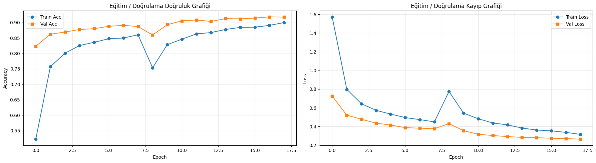
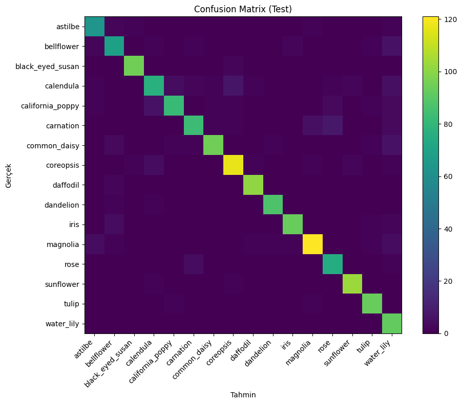
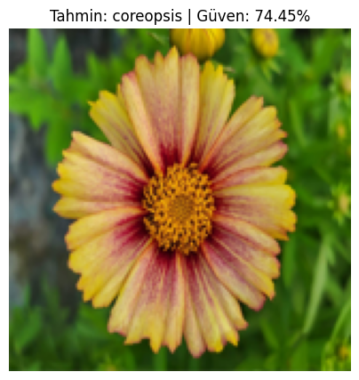

# Çiçek Görüntü Sınıflandırma (MobileNetV2)

[](https://colab.research.google.com/github/yunusemrearslan37/flower-classification-mobilenetv2/blob/main/sinir_final.ipynb)

Kaggle [Flowers](https://www.kaggle.com/datasets/l3llff/flowers) veri setinde **16 çiçek sınıfını** ayıran bir **transfer learning** + **fine-tuning** projesi.

## Öne çıkanlar

| Madde | Detay |
|------|--------|
| Model | MobileNetV2 (ImageNet pretrained) |
| Input size | 160×160 |
| Sınıf sayısı | 16 |
| Pipeline | Stage-1 head training → Stage-2 fine-tune (son 20 katman) |
| Metrikler | Accuracy, Precision, Recall, F1, confusion matrix |

## Veri seti

- **Kaynak:** [Flowers (Kaggle)](https://www.kaggle.com/datasets/l3llff/flowers)
- **Toplam:** 15.740 görsel, 16 sınıf
- **Split:** Train 12.592 (%80) · Validation ~1.570 (%10) · Test ~1.580 (%10) (`seed=42`)
- **Sınıflar:** astilbe, bellflower, black_eyed_susan, calendula, california_poppy, carnation, common_daisy, coreopsis, daffodil, dandelion, iris, magnolia, rose, sunflower, tulip, water_lily
- Hafif data augmentation: RandomFlip, RandomRotation, RandomZoom + class weight

## Sonuçlar (test set)

| Metrik | Skor |
|--------|------:|
| Accuracy | **91.52%** |
| Precision (macro) | 91.59% |
| Recall (macro) | 91.61% |
| F1-Score (macro) | **91.40%** |

### Eğitim grafikleri



### Confusion Matrix (test)



### Örnek tahmin



## Kullanılan teknolojiler

- Python, TensorFlow / Keras
- scikit-learn (metrikler)
- Matplotlib / Seaborn (grafikler)
- kagglehub (veri seti indirme)
- Google Colab (T4 GPU önerilir)

## Nasıl çalıştırılır?

1. [`sinir_final.ipynb`](sinir_final.ipynb) dosyasını [Google Colab](https://colab.research.google.com) veya Jupyter'da aç (yukarıdaki Colab rozetine tıklaman yeterli).
2. Runtime → Change runtime type → **GPU**.
3. Hücreleri yukarıdan aşağı sırayla çalıştır.

```bash
pip install -r requirements.txt
```

Veri seti notebook içinde Kaggle üzerinden indirilir. Büyük veri dosyaları bu repoda tutulmaz.

## Proje yapısı

```text
flower-classification-mobilenetv2/
├── README.md
├── requirements.txt
├── .gitignore
├── sinir_final.ipynb
└── images/
    ├── training_curves.png
    ├── confusion_matrix.png
    └── sample_prediction.png
```

## Lisans

Eğitim / portfolio amaçlı proje. Veri seti lisansı Kaggle kaynak sayfasındaki koşullara tabidir.
